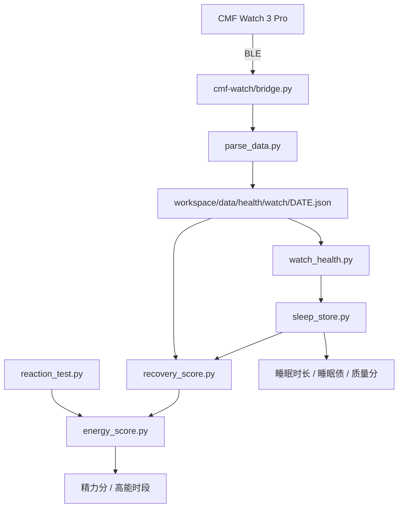

<div align="center">

# Cadence / 节律

**焕新CMF Watch 3 Pro健康数据自动同步工具2.0**

*Local-first sleep, recovery and energy for your watch.*


</div>

> **看不懂怎么用？** 把这个仓库和 README 直接扔给你的 AI 助手，说一句「按这个帮我装依赖、连手表、跑一次同步和自测」。

---

## 目录

- [这个项目是什么](#这个项目是什么)
- [工作原理](#工作原理)
- [能力范围](#能力范围)
- [快速开始](#快速开始)
- [算法口径](#算法口径)
- [配置项](#配置项)
- [目录结构](#目录结构)
- [自测](#自测)
- [隐私与脱敏](#隐私与脱敏)
- [已知限制](#已知限制)
- [旧版 ADB 导出](#旧版-adb-导出)
- [License](#license)

## 这个项目是什么

`Cadence` 是一个本地优先的 CMF Watch 3 Pro 工具链：

- 通过 BLE 直连手表，读取睡眠、睡眠窗口心率、血氧、压力等夜间数据；
- 写入本地睡眠账本，计算动态目标、睡眠债、质量分、恢复分；
- 基于恢复分和近 7 天睡眠债变化，生成校准期精力分与初步高能时段；
- 提供一个桌面反应力小测，把带时间戳的反应数据接入个人模型特征；
- 不依赖手机 App、不需要 root，也不上传个人健康数据。

项目从个人 N=1 使用场景中抽离而来。仓库内**不包含任何真实睡眠记录、设备 authkey、飞书 ID 或本机路径**。

## 工作原理



核心原则：

1. **手表是数据源，本地是唯一存储**；
2. **睡眠按醒来那天归属**；
3. **同步失败不伪造数据**，缺项就标记缺项；
4. **恢复/精力分是个人参考，不是医学指标**；
5. 自评和 events 只作为训练标签，不直接修正当天预测分。

## 能力范围

| 模块 | 能力 |
|---|---|
| BLE 同步 | 睡眠会话、睡眠阶段、睡眠窗口心率、血氧、压力 |
| 睡眠账本 | 动态目标、睡眠债、质量分、规律性、连续达标 |
| 恢复分 | 固定绝对项 + 个人百分位项，权重可复核 |
| 精力分 | 恢复分 + 近 7 天债变化；自评只做训练标签 |
| 高能时段 | 校准期模板；后续由日内曲线替换 |
| 反应力测试 | 8 次空格反应，日报聚合，接入个人模型特征 |
| 旧版兼容 | `legacy/` 保留 ADB + Excel 导出方案 |

## 快速开始

### 1. 准备环境

- Python 3.12+
- Windows 10/11 或 Linux（macOS 需自行适配 BLE 权限）
- 支持 CMF Watch 3 Pro 的蓝牙适配器

```bash
git clone https://github.com/YTZ-create/cadence.git
cd cadence
python -m pip install -r requirements.txt
```

### 2. 确认手表

```bash
python -X utf8 cmf-watch/probe_scan.py
```

记下手表地址，或直接依赖名称扫描。

### 3. 启动 BLE 桥

```bash
python -X utf8 cmf-watch/bridge.py
```

桥只监听 `127.0.0.1:8765`，不对外网开放。

### 4. 同步与查看

```bash
python -X utf8 workspace/scripts/watch_health.py status
python -X utf8 workspace/scripts/watch_health.py sync
python -X utf8 workspace/scripts/watch_health.py report
```

### 5. 计算恢复/精力分

```bash
python -X utf8 workspace/scripts/recovery_score.py --date 2026-01-15 --json
python -X utf8 workspace/scripts/energy_score.py predict --date 2026-01-15 --json
```

### 6. 反应力测试

```bash
python -X utf8 workspace/scripts/reaction_test.py
```

双击窗口后按空格开始；看到白点按空格，鼠标点击不计。结果写入本地 `workspace/data/health/reaction/`。

## 算法口径

完整公式、权重、缺失处理和验证边界见 [docs/ALGORITHMS.md](docs/ALGORITHMS.md)。

简要版：

### 恢复分

| 分项 | 口径 | 权重 |
|---|---|---:|
| 睡眠时长达成 | 固定绝对 | 30 |
| 连续性/效率 | 固定绝对 | 15 |
| 深睡占比 | 个人百分位 | 15 |
| HR dip | 个人百分位 | 20 |
| 阶段心率梯度 | 个人百分位 | 5 |
| 血氧 | 固定安全阈值 | 10 |
| 压力 | 个人百分位（反向） | 5 |

个人百分位映射：5%→40、25%→60、50%→75、75%→90、95%→100。基线不足 14 晚时退回固定参考。

### 精力分

```text
精力分 = 恢复分 - 近 7 天睡眠债变差惩罚
```

- 债变差最多扣 4 分；债稳定或改善不扣；
- 自评/events 只作为个人模型训练标签，不参与当天评分；
- 个人模型 45 天可试训、60 天且时间外验证通过才启用；
- 高能时段当前是**校准期模板**，个人模型激活时回退模板，不会消失。

### 高能时段

- 主窗口 120 分钟、下午窗口 120 分钟；
- 最近 7 天债恶化 ≥2 小时：主窗口缩至 90 分钟，总 3小时30分钟；
- 债稳定/改善：总 4小时；
- 模板保留为长期 fallback；只有 events 覆盖多时段多天、日内曲线通过时间外验证后，才切换为 `curve`。

### 反应力

- 每次 8 个试次；日报聚合当天中位数、漏拍总数、误点总数、距起床时间中位数；
- 训练特征：`rt_median`、`rt_lapses`、`rt_false_starts`、`rt_time_since_wake`、`rt_missing`；
- 没有测试时 `rt_missing=1`，不会把“没测”静默当成中位数。

## 配置项

| 环境变量 | 作用 | 默认 |
|---|---|---|
| `CMF_WATCH_ADDRESS` | 手表 BLE 地址 | 按名称扫描 |
| `CMF_WATCH_NAME` | 手表名称匹配 | `CMF Watch 3 Pro` |
| `OPENCLAW_STATE_DIR` | 工作区根目录 | 仓库根目录 |
| `OPENCLAW_CLI` | OpenClaw CLI 路径 | PATH 中的 `openclaw` |
| `OPENCLAW_CONFIG` | OpenClaw 配置文件 | 仓库根目录 `openclaw.json` |
| `CMF_FEISHU_CHAT_ID` | 可选飞书私聊通知目标 | 关闭通知 |
| `CMF_MORNING_JOB_ID` | 可选早报 cron ID | 不触发早报 |

所有环境变量都可以不设置；BLE 同步、睡眠账本、恢复分、精力分和反应力测试可独立使用。飞书/OpenClaw 集成是可选层。

## 目录结构

```text
.
├── cmf-watch/
│   ├── bridge.py              # BLE HTTP 桥
│   ├── parse_data.py          # 帧解析
│   ├── analyze_sleep.py       # 人工核对脚本
│   ├── enable-bt.ps1          # Windows 蓝牙开关
│   ├── probe_scan.py          # BLE 扫描
│   └── tools/                 # AGPL-3.0 手表协议工具
├── workspace/scripts/
│   ├── watch_health.py        # 同步/归档/报告入口
│   ├── watch_auto_sync.py     # 自动同步与可选通知
│   ├── sleep_store.py         # 睡眠账本与派生指标
│   ├── recovery_score.py      # 恢复分
│   ├── energy_score.py        # 精力分/高能时段
│   ├── energy_onboarding.py   # 冷启动问卷
│   └── reaction_test.py       # 桌面反应力测试
├── docs/                      # 算法、数据格式、隐私
├── examples/                  # 合成示例，不含真实数据
├── legacy/                    # 旧 ADB + Excel 导出方案
├── VERSION                    # 2.0
└── README.md
```

## 自测

```bash
python -X utf8 workspace/scripts/recovery_score.py --selftest
python -X utf8 workspace/scripts/energy_score.py selftest
python -X utf8 workspace/scripts/reaction_test.py selftest
```

自测使用临时目录，不读写真实健康数据。

## 隐私与脱敏

- 仓库不包含真实睡眠、心率、血氧、压力、反应力或自评数据；
- `cmf-watch/tools/.watch_state.json` 含设备 secret/authkey，已被 `.gitignore` 排除；
- 手表地址、飞书 open_id、cron ID 和本机路径已改为环境变量/占位符；
- 第三方工具的 authkey/sessionKey 调试输出已脱敏；
- 同步数据默认只写本地；飞书通知为可选功能，未配置时不发送；
- 详见 [docs/PRIVACY.md](docs/PRIVACY.md)。

## 已知限制

- 手表协议来自社区逆向，固件升级可能改变帧格式；
- 手表一次只允许一个 BLE 客户端，手机 App 连接时电脑无法同步；
- 夜间心率/血氧/压力是稀疏采样，不能当作连续曲线；
- 睡眠阶段和深睡时长为设备估算，不是多导睡眠图；
- 恢复分/精力分是个人参考，不构成医学诊断；
- 高能时段目前是校准模板，尚未用足够时间标签训练日内曲线；
- 个人模型尚未在本仓库附带个人数据上训练，训练门槛为 45/60 天。

## 旧版 ADB 导出

`legacy/` 保留了早期 ADB + Excel 导出方案：

```bash
cd legacy
python -m pip install -r ../requirements.txt
cp config.example.py config.py
python cmf_sync.py
```

旧方案需要手机开启无线调试、7-Zip 和 Chrome；新方案优先推荐 BLE 直连。

## License

- 本项目原创代码：MIT，见 [LICENSE](LICENSE)；
- `cmf-watch/tools/` 来自 `arnav-kr/cmf-watch-utils`，AGPL-3.0，见 [cmf-watch/LICENSE](cmf-watch/LICENSE)；
- 若将 AGPL 组件与本项目一起分发，请遵守 AGPL-3.0 的相应义务；详见 [NOTICE](NOTICE)。
