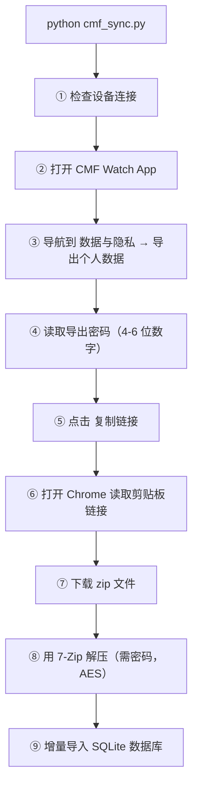

<div align="center">

# CMF Watch 健康数据自动同步工具 (cmf-sync)

**用 ADB 遥控手机导出 Nothing CMF Watch 的健康数据，解密后增量入库到本地 SQLite。**

Automate exporting health data from a Nothing CMF Watch via ADB, decrypt it, and incrementally import into a local SQLite database.


</div>

> 💡 **看不懂怎么用？** 别啃文档——把这个仓库（或这份 README）扔给你的 AI 助手，说一句「按这个帮我把 CMF Watch 数据同步配好」，让它读完替你装 adb / 7-Zip、改 `config.py`、连上手机跑 `cmf_sync.py` 就行。

---

## 目录

- [功能特性](#功能特性)
- [支持的数据类型](#支持的数据类型)
- [工作原理](#工作原理)
- [依赖](#依赖)
- [配置](#配置)
- [使用方法](#使用方法)
- [查看数据](#查看数据)
- [注意事项](#注意事项)
- [项目结构](#项目结构)
- [故障排除 FAQ](#故障排除-faq)
- [许可证与致谢](#许可证与致谢)

---

## 功能特性

- 📱 **自动导出** — 通过 ADB 控制手机自动打开导出页面
- 🔐 **密码识别** — 自动从 UI 中读取导出密码
- 🔗 **链接提取** — 从 Chrome 浏览器中读取导出链接
- 📦 **自动下载** — 下载加密的 zip 文件
- 🗜️ **解密解压** — 使用 7-Zip 解压 AES 加密的 zip
- 💾 **增量入库** — 导入到 SQLite，支持增量更新（不会重复插入）

## 支持的数据类型

- ❤️ 24 小时心率
- 💓 静息心率
- 😰 压力数据
- 🫁 血氧数据
- 🏃 今日活动（步数、卡路里、运动时长等）
- 🏋️ 运动记录（类型、时长、距离、VO2max 等）
- 👤 账号信息（昵称、性别、生日、身高、体重）

## 工作原理



## 依赖

### 系统依赖

1. **Android Debug Bridge (adb)**
   - 下载：<https://developer.android.com/tools/releases/platform-tools>
   - 确保 `adb` 在 PATH 中，或在 `config.py` 中指定完整路径
2. **7-Zip**
   - Windows：<https://www.7-zip.org/>
   - macOS：`brew install p7zip`
   - Linux：`apt-get install p7zip-full`
   - 用于解压 AES 加密的 zip 文件（Python 的 `zipfile` 不支持）
3. **curl**
   - Windows 10+ 已内置
   - macOS/Linux 通常已安装

### Python 依赖

```bash
pip install -r requirements.txt
```

## 配置

1. 复制配置模板：

   ```bash
   cp config.example.py config.py
   ```

2. 编辑 `config.py`，根据你的系统修改路径：

   ```python
   # ADB 路径
   ADB_PATH = r'C:\platform-tools\adb.exe'  # Windows
   # ADB_PATH = '/usr/local/bin/adb'  # macOS/Linux

   # 7-Zip 路径
   SEVENZIP_PATH = r'C:\Program Files\7-Zip\7z.exe'  # Windows
   # SEVENZIP_PATH = '/usr/bin/7z'  # macOS/Linux

   # 数据库路径
   DB_PATH = './data/health.db'
   RAW_DIR = './data/raw'
   ```

## 使用方法

### 1. 准备手机

1. 确保手机和电脑在同一 Wi-Fi 网络
2. 在手机上开启**无线调试**：开发者选项 → 无线调试 → 开启；使用配对码配对设备（首次需要）
3. 在电脑上配对：

   ```bash
   adb pair <手机IP>:<配对端口>
   # 输入配对码
   ```

4. 连接设备：

   ```bash
   adb connect <手机IP>:<连接端口>
   ```

### 2. 运行同步

```bash
python cmf_sync.py
```

脚本会自动完成上面「工作原理」里的 ①～⑨ 全部步骤。

## 查看数据

```bash
sqlite3 data/health.db

# 查看心率数据
SELECT * FROM heart_rate_24h ORDER BY ts DESC LIMIT 10;

# 查看运动记录
SELECT * FROM exercise ORDER BY start_ts DESC;

# 查看数据统计
SELECT 'heart_rate_24h', COUNT(*) FROM heart_rate_24h
UNION ALL
SELECT 'exercise', COUNT(*) FROM exercise;
```

## 注意事项

### 7 天导出限制

CMF Watch App 有 **7 天导出窗口限制**：

- 导出后 7 天内不能重复导出
- 如果尝试在限制期内导出，脚本会提示失败
- 建议每周固定一天（如周日）进行同步

### 无线调试

- 手机重启后需要重新连接 adb
- 如果连接失败，尝试：

  ```bash
  adb kill-server
  adb start-server
  adb connect <手机IP>:<端口>
  ```

### Chrome 剪贴板

- 脚本依赖 Chrome 的剪贴板预览功能
- 如果 Chrome 版本不同导致 UI 变化，可能需要调整 `read_link_from_chrome()` 函数
- 确保手机已安装 Chrome 浏览器

## 项目结构

```
.
├── cmf_sync.py              # 主同步脚本
├── cmf_health_import.py     # Excel 导入脚本
├── config.example.py        # 配置模板
├── config.py                # 你的配置（不提交到 git）
├── requirements.txt         # Python 依赖
├── data/                    # 数据存储目录
│   ├── health.db            # SQLite 数据库
│   └── raw/                 # 原始 Excel 文件
└── README.md                # 本文档
```

## 故障排除 FAQ

**Q：设备未连接？**

```bash
adb devices                 # 检查设备
adb connect <手机IP>:<端口>  # 重新连接
```

**Q：无法导航到导出页？**
A：确保 CMF Watch App 已登录；手动打开 App 检查能否进入「数据与隐私」页面；若 UI 更新，可能需要调整 `open_export_page()` 中的关键词。

**Q：Chrome 中找不到链接？**
A：确保点击了「复制链接」按钮；检查 Chrome 是否为默认浏览器；也可手动复制链接（在脚本中硬编码，不推荐）。

**Q：解压失败？**
A：确保 7-Zip 已正确安装；检查 `config.py` 里的 `SEVENZIP_PATH`；手动测试 `7z x file.zip -p密码`。

## 许可证与致谢

**License**：[MIT](LICENSE)

**贡献**：欢迎提交 Issue 和 Pull Request！

**致谢**：

- [Android Debug Bridge](https://developer.android.com/tools/adbd)
- [7-Zip](https://www.7-zip.org/)
- [openpyxl](https://openpyxl.readthedocs.io/)
